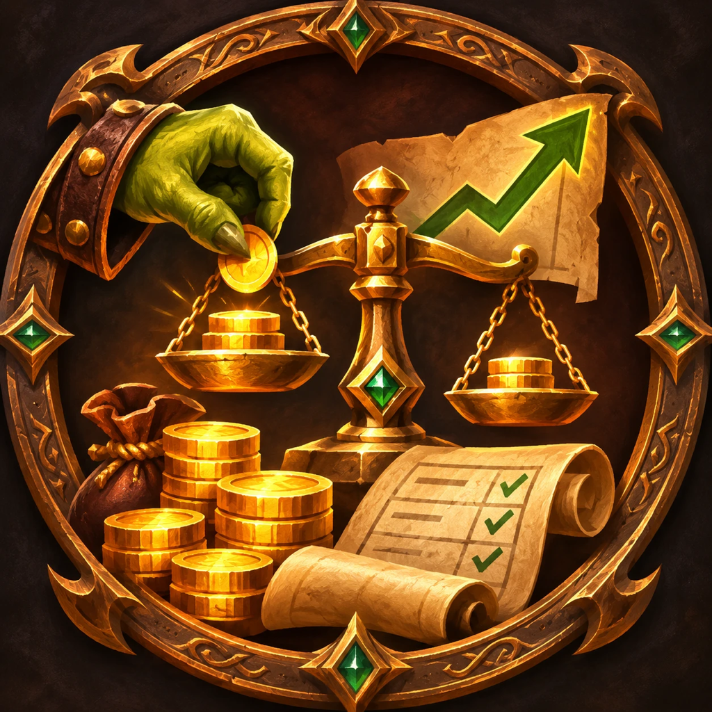

# Négoce

An addon for **WoW Forever** that runs your in-game business: net worth, portfolio, auction house
prices, cost price of your items and profitability of profession recipes. It only watches and
calculates: it never buys or sells anything for you. English and French interface.

## Usage

- **Open**: minimap button, or `/negoce` (`/ng`). `/negoce help` lists the commands.
- **Language**: follows your game language (French on a French client, English otherwise). To
  change it: `/negoce language en`, `/negoce language fr`, or `/negoce language auto` to follow the
  game again.
- **Auction house prices**: at the auction house, click "Négoce: scan prices". Your own searches
  also update prices.
- **Finances**: net worth (gold + stock) with its history chart, portfolio with the average cost
  price of each item, gold flows, purchases and sales with the margin made on each sale. The cost
  price also shows in item tooltips.
- **Production**: a graph of recipes (raw materials, components, finished products), with the cost
  and profit of each recipe, for the recipes you know or the whole profession.

## Development

| Path | Purpose |
|---|---|
| `Data/Recettes.lua` | recipe table, generated by `outils/generer_donnees.py` from the client tables on wago.tools (product `wowf`): run it again after a patch |
| `Art/` | textures, generated by `outils/generer_textures.py` |
| `Locales/` | texts: the French text is the key (`L["Patrimoine"]`), `enUS.lua` holds the English |
| `outils/test_hors_jeu.lua` | offline test against a fake game API, with a French then an English client: `lua outils/test_hors_jeu.lua`. It fails if a text has no English translation |
| `.pkgmeta` | builds the .zip with the [BigWigs packager](https://github.com/BigWigsMods/packager) |

The code and its comments are in French.

The libraries (`Libs/`: LibStub, CallbackHandler, LibDataBroker, LibDBIcon) are not in the
repository: the packager adds them to the .zip. To play from a copy of the repository, take the
published .zip or copy these libraries from another addon.

## Releasing a version

1. Set the same version number in `Negoce.toc` (`## Version`) and `Core.lua` (`ns.VERSION`).
2. Add a section for the version at the top of `CHANGELOG.md`: it is shown on CurseForge.
3. Commit, then tag and push: `git tag v1.2.0 && git push && git push origin v1.2.0`.
4. The *Publier* GitHub action runs the offline test, builds the .zip and uploads it to
   CurseForge.

## License

MIT, see [LICENSE](LICENSE). The libraries added to the .zip keep their own licenses.
